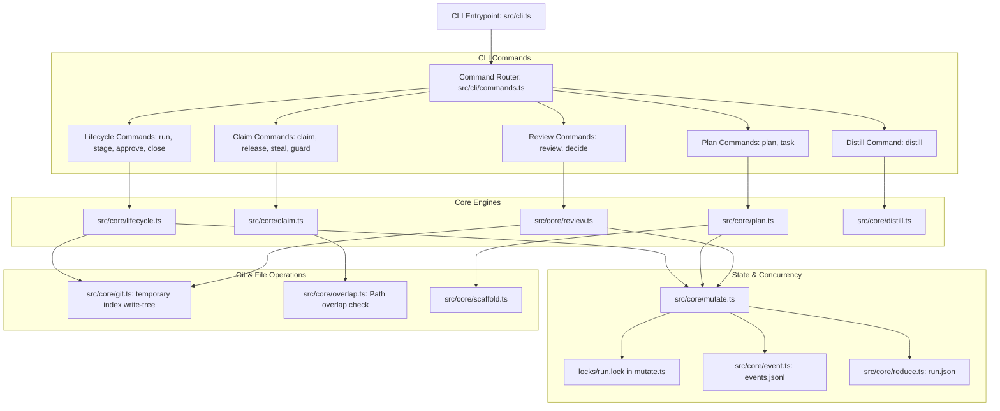
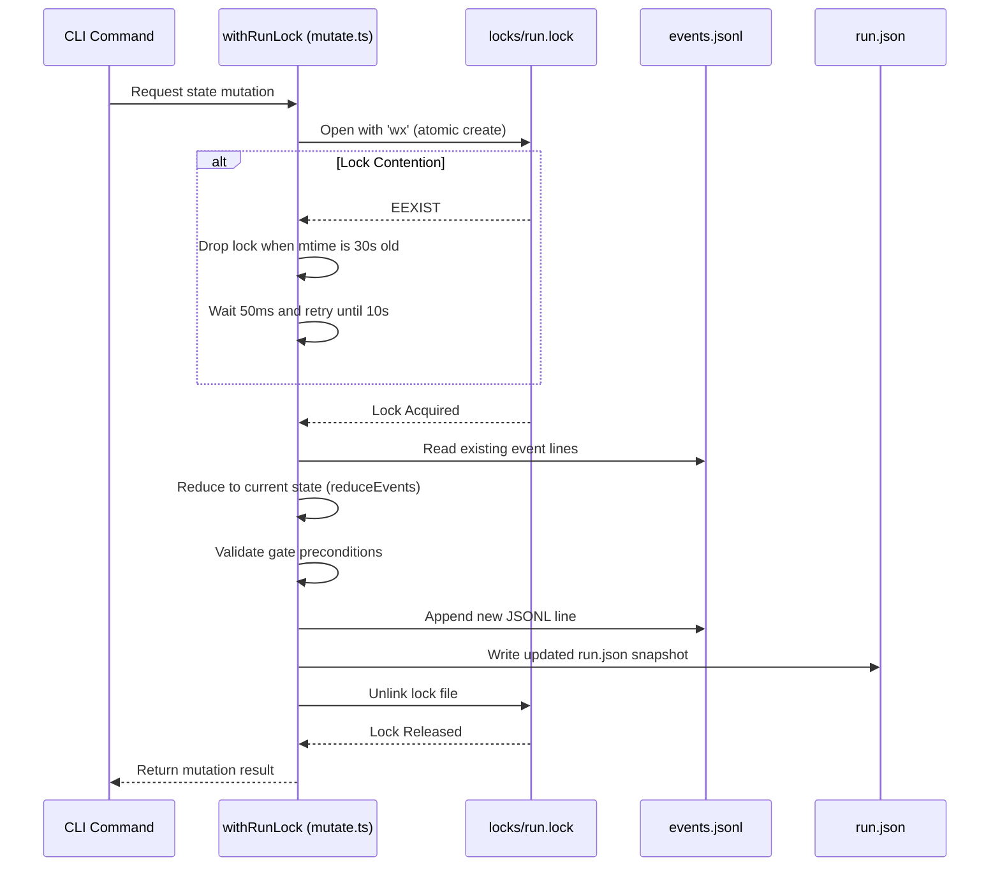

# Component Diagrams

This document illustrates the internal module structure of the `atry` CLI and how components interact.

## High-Level Component Interaction

## Concurrency and Storage Lock Flow

