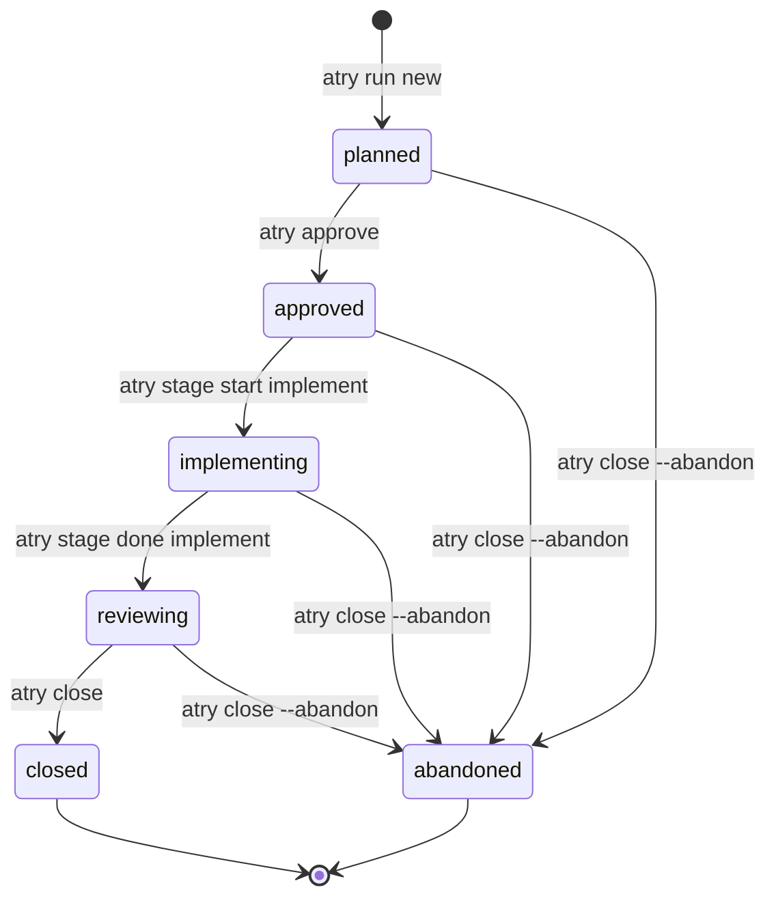

# State Transitions

This document specifies valid state transitions and guard conditions across the run lifecycle.

## State Transition Diagram

## Transition Rules

| From           | To             | Command                             | Preconditions                                                                                                                                                                                    |
| -------------- | -------------- | ----------------------------------- | ------------------------------------------------------------------------------------------------------------------------------------------------------------------------------------------------ |
| `planned`      | `approved`     | `atry approve --via <confirm\|arg>` | The run is `planned`. Approval does not count tasks.                                                                                                                                             |
| `approved`     | `implementing` | `atry stage start implement`        | The plan is approved.                                                                                                                                                                            |
| `implementing` | `reviewing`    | `atry stage done implement`         | Every plan task is `done` or `skipped`. Edits outside task files need `--allow-extra`.                                                                                                           |
| `reviewing`    | `closed`       | `atry close`                        | Required reviews match the base policy, unless `--waive-review` is set. The latest review tree matches the current tree. Open questions need `--ack-open`. A reviewer delta needs `--ack-fixes`. |
| Any open state | `abandoned`    | `atry close --abandon <reason>`     | The reason is non-empty. `closed` and `abandoned` stay terminal.                                                                                                                                 |
