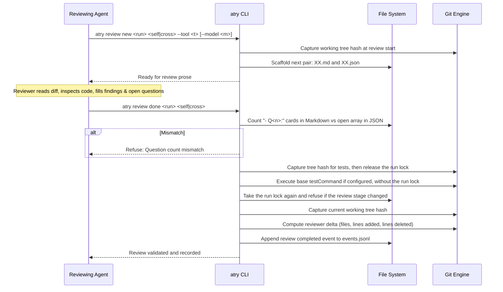

# Review Lifecycle

The review workflow enforces a two-step cycle: scaffolding initialization followed by comprehensive validation (`src/core/review.ts`).

`atry close <run> --preview` lists missing reviews, tree mismatches, reviewer
changes, open items, and failed tests. When `strict.reviewIntegrity` is false,
these items are warnings. The developer can choose to continue by invoking
`atry close` with `--via confirm` or `--via arg`. The close event records any
warnings. When the setting is true, existing close gates remain in force.

`atry review done` records a `delta` when the reviewer changed code after that
review started. A cross-review delta needs a self-review completed after it,
because the earlier self-review did not see that code. `atry close` refuses the
run until one is recorded, and `--ack-fixes` does not replace it.
`atry next` recommends `atry review new <run> self` in that state. With
`strict.reviewIntegrity` false, the missing self-review is one more warning.

## Review Lifecycle Steps

