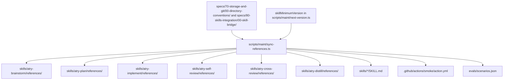

# Reference Synchronization Pipeline

Shared convention parts and partial texts are maintained in canonical locations under `specs/` and synchronized into distributed skill bundles via `scripts/maint/sync-references.ts`.

## Pipeline Flow



## CLI Floor

`skillMinimumVersion` in `scripts/maint/next-version.ts` is the only place that holds the skill CLI floor.
`npm run sync` writes it into three targets:

- The `requires-atry` line in each of the six `skills/*/SKILL.md` files.
- The `atry preflight --requires` line in `.github/actions/smoke/action.yml`.
- Each floor string and each `installed` value in `evals/scenarios.json`.

`npm run sync:check` fails on drift in any of them.
To bump the floor, edit `skillMinimumVersion` and run `npm run sync`.

## CI Verification

Continuous Integration runs:

```bash
npm run sync:check
```

- Verifies that no manual edits were made directly to bundle references.
- Checks `skills/*/references/` in this repository. It does not update skills installed under a home directory.
- Fails with exit code `1` if drift is detected.
